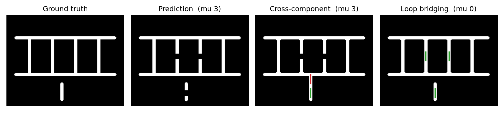

# vessel-topofix

Training-free topology repair for vessel segmentations. Starting from a network's binary mask and its foreground
probability map, it applies morphological closing, removes small components, and bridges broken vessels on the
pruned skeleton. Loop bridging also reconnects a tip to its own vessel piece, which closes broken loops.

Pipeline (`topofix.refine`):

1. closing with a disk of radius `r` (2 for full training data, 3 for single-image models in the paper)
2. removal of components under 20 px
3. Lee skeleton, tip spurs under 5 px pruned
4. bridges: from each skeleton tip, a minimal path on `1 - probability` to a skeleton pixel within `R` px and
   `angle` degrees ahead of the tip, kept if the mean probability along it is at least `p_min`
5. bridges painted as discs of 0.8 × the local vessel radius

| Setting | Targets | R | angle | p_min | k |
|---|---|---|---|---|---|
| `LOOP_PAPER` (ours) | other components and the tip's own piece | 50 | 20 | 0.5 | 8 |
| `CROSS_COMP` (baseline) | other components only | 30 | 20 | 0.2 | – |

`k`: an own-piece target is used only if the path to it along the skeleton is at least `k` × (and at least 30 px
more than) the straight distance, so a vessel is not joined to itself where it simply bends.

## Install

```
pip install -r requirements.txt
```

Python 3.10 or newer. `nnunetv2` is needed only for `scripts/train_predict.py`.

## Demo

```
python demo.py
```

A synthetic ladder with two broken rungs and a broken separate vessel. Cross-component bridging cannot close a
loop and adds one wrong bridge; loop bridging repairs all three gaps (Betti matching error μ 3 → 0).



## Run on your own data

In Python:

```python
from topofix import refine, LOOP_PAPER
from topofix import metrics

refined, bridges = refine(mask, prob, r=2, setting=LOOP_PAPER)  # mask: bool (H, W), prob: float (H, W) in [0, 1]
print(metrics.betti_matching(refined, gt), metrics.dice(refined, gt))
```

With nnU-Net v2, from image and mask folders (same file names in both):

```
python scripts/train_predict.py train   --images train/images --masks train/masks --work nnunet_work
python scripts/train_predict.py predict --images test/images --gt test/masks --work nnunet_work --out results/full
```

`predict` writes one folder per test image with `nnunet_mask.png`, `prob_fg.npy` and `gt_mask.png`. For
single-image models, train one model per annotated image (separate `--work` or `--dataset-id`) and predict each
into its own folder.

The paper trained with `nnUNetTrainer_50epochs`, the `2d` configuration and fold `all`, on the first image channel.

## Metrics

`topofix.metrics`: Dice, clDice, Boundary IoU, ASSD, Betti numbers and their error, Betti matching error
(μ0, μ1, μ), vessel ends and junctions, and bridge correctness. ASSD is in pixels unless a pixel size `px` is
given.

## Tests

```
python tests/test_core.py
```

Synthetic data only. `python -m pytest tests` works too if pytest is installed.

## Data

The retina images and annotations used in the paper are not included.

## Citation

Paper under review. The citation will be added here.

## License

MIT, see `LICENSE`. `third_party/BettiMatching.py` is third-party code under its own MIT license, see
`THIRD_PARTY.md`.
